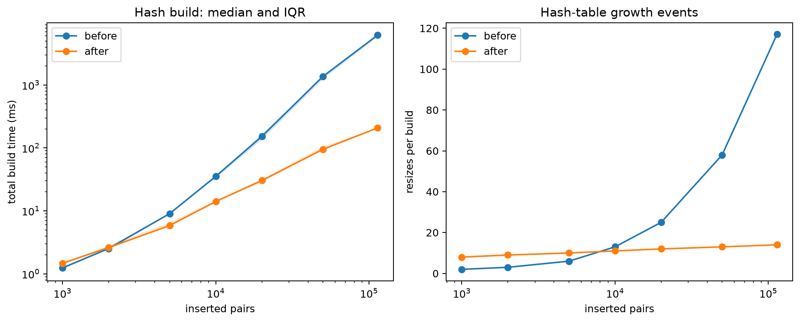

# INC-03: Hash-table growth repeatedly rehashes the table

## Summary

The hash table increased capacity by a fixed 1,024 buckets. Each growth rehashed every distinct key, making large builds much more expensive than expected. Changing capacity growth to doubling fixes the amortized behavior. In the clean verification runs, the 114,000-pair median build time changes from 6,217.307 ms to 208.138 ms (29.87 times before/after), and resizes fall from 117 to 14.

## Detection

Code review identified additive growth in `_grow`. The E1 build measurements confirm the problem: before the fix, resizes grow from 2 at 1,000 pairs to 117 at 114,000, while the cost per inserted pair increases substantially. Point-lookup timings alone would not expose the repeated rehashing, because query batches reset counters after the build.

## Expected vs. observed

With geometric growth and a reasonable hash distribution, insertion has expected amortized O(1) work and a full build has expected O(n) work. With d distinct keys, the number of resizes should grow logarithmically. A fixed growth step instead produces repeated scans of an increasingly large table, giving quadratic total rehash work in d asymptotically.

### Clean before/after measurements

Machine: `oscar-omen`. Before: `fa70927`, session `39da8fbcc1b3`. After: `584f39d`, session `52cd11d6d84d`. Each configuration has five replicates. Times below are total build milliseconds, summarized by median and interquartile range; resize counts are per complete build.

| Inserted pairs | Before build ms [Q25, Q75] | After build ms [Q25, Q75] | Resizes before | Resizes after |
|---:|---:|---:|---:|---:|
| 1,000 | 1.243 [1.177, 1.247] | 1.470 [1.406, 1.500] | 2 | 8 |
| 2,000 | 2.517 [2.506, 2.696] | 2.610 [2.581, 2.800] | 3 | 9 |
| 5,000 | 9.020 [9.004, 9.183] | 5.839 [5.641, 6.527] | 6 | 10 |
| 10,000 | 35.332 [32.997, 35.756] | 14.060 [13.906, 14.552] | 13 | 11 |
| 20,000 | 152.391 [135.256, 164.077] | 30.361 [28.536, 31.825] | 25 | 12 |
| 50,000 | 1,363.242 [1,232.956, 1,365.024] | 94.858 [94.236, 104.781] | 58 | 13 |
| 114,000 | 6,217.307 [5,847.464, 6,366.854] | 208.138 [203.479, 208.415] | 117 | 14 |



*Figure INC-03. Geometric growth removes the steep increase in large-build time and reduces growth events. Lines show medians; the timing band shows Q25–Q75. Source: the main code cell in `analysis/INC03_hash_growth.ipynb`, using the clean E1 sessions above. *

### Historical measurements

The table uses actual saved E1 rows from oscar-omen: before `9598854-dirty`, after `bc253d0-dirty`, five replicates per configuration. Times are medians with interquartile ranges. These labels are historical dirty-source labels, not clean verification runs.

| Inserted pairs | Before build ms [Q25, Q75] | After build ms [Q25, Q75] | Resizes before | Resizes after |
|---:|---:|---:|---:|---:|
| 1,000 | 1.183 [1.182, 1.233] | 1.285 [1.184, 1.288] | 2 | 8 |
| 2,000 | 2.481 [2.413, 2.733] | 2.225 [2.195, 2.359] | 3 | 9 |
| 5,000 | 8.293 [7.420, 8.498] | 5.203 [5.084, 5.455] | 6 | 10 |
| 10,000 | 33.464 [31.293, 34.355] | 11.010 [10.993, 11.708] | 13 | 11 |
| 20,000 | 156.413 [126.760, 195.653] | 37.518 [34.708, 38.474] | 25 | 12 |
| 50,000 | 1,443.081 [1,237.754, 1,537.828] | 85.125 [84.414, 87.724] | 58 | 13 |
| 114,000 | 6,695.683 [5,951.802, 7,091.271] | 214.467 [212.517, 231.249] | 117 | 14 |

## Evidence

- Raw measurements: `results/timings.csv`, `experiment=E1_build_memory`, `index_type=hash_table`, `machine_id=oscar-omen`. The clean sessions are `39da8fbcc1b3` (`fa70927`) and `52cd11d6d84d` (`584f39d`); each contains 35 hash-table rows across seven sizes. Historical rows remain under their original labels.
- Full-data added structure memory is 20.454 MiB before and 21.233 MiB after. The helper measures memory once per configuration and repeats the value in the timing rows; these are not five independent memory samples.
- The resize counter measures expansion events. It does not count every key moved during rehashing; the code explains the extra work per event.

## Root cause

In the pre-fix `indexes/hash_table.py`, `_grow` computes `len(self._buckets) + self.GROWTH_STEP` (line 60 in the pre-fix file). It then visits every bucket and relocates every entry into the new table. Correct bucket placement is maintained, so the returned answers remain correct despite excessive rebuilding.

## Fix

Commit `bc253d0` changes capacity to `2 * len(self._buckets)` and removes `GROWTH_STEP`.

```diff
diff --git a/indexes/hash_table.py b/indexes/hash_table.py
index d6de160..4c86d0d 100644
--- a/indexes/hash_table.py
+++ b/indexes/hash_table.py
@@ -28,7 +28,6 @@ class HashTableIndex(Index):
 
     INITIAL_CAPACITY = 8
     MAX_LOAD_FACTOR = 0.75   # average keys per bucket before the table grows
-    GROWTH_STEP = 1024       # buckets added each time the table grows
 
     def __init__(self, capacity: int = INITIAL_CAPACITY) -> None:
         super().__init__()
@@ -57,7 +56,7 @@ class HashTableIndex(Index):
 
     def _grow(self) -> None:
         """Move every entry into a larger list of buckets."""
-        new_capacity = len(self._buckets) + self.GROWTH_STEP
+        new_capacity = 2 * len(self._buckets)
         new_buckets: list[list[tuple[Any, list[Any]]]] = [[] for _ in range(new_capacity)]
         for bucket in self._buckets:
             for entry in bucket:
```

## Verification

The clean E1 baseline is `fa70927`, session `39da8fbcc1b3` (2026-11-10 04:52:15–04:54:28 UTC); the final run is `584f39d`, session `52cd11d6d84d` (04:59:20–05:00:16 UTC). Both source labels are recorded without `-dirty`. Each session contains all 245 E1 rows: seven indexes, seven sizes, five distinct replicates, with no duplicate configuration/replicate rows.

Both runs use the same machine, dataset, file insertion order, size grid and workload notes. The recorded environment is Docker, Python 3.13.18 and `PYTHONHASHSEED=0`. The full-size hash build has 117 resizes before and 14 after in every replicate. Added structure memory changes from 20.454 to 21.233 MiB, about 3.8% higher; the build-time ratio is 29.87. The small 1,000- and 2,000-pair builds do not improve in median time, so the benefit is workload dependent.

Reported Docker correctness check after the E4 cleanup: `docker compose run --rm app python -m pytest` returned **168 passed, 3 skipped in 6.49s**. Historical rows and version labels remain unchanged.

## Impact on recommendations

The clean measurements make the fixed hash table a much stronger catalog-import candidate for F4 at large sizes. Doubling retains spare buckets, so the final build-time benefit must be weighed against E1 memory and the queries required by the catalog. A hash table still needs a full scan for range and prefix queries; the growth fix does not change that limitation.

## Why the tests didn't catch it

The correctness tests check stored/retrieved values. Rehashing too often still places every key correctly. A structural diagnostic over growing unique-key workloads could check that resize count grows logarithmically. The supplied tests remain unchanged.
