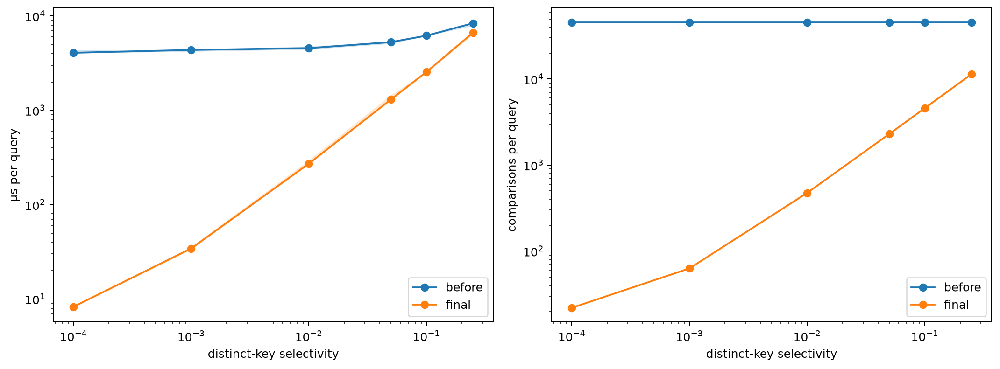

# INC-04: B+ range queries traverse every subtree

## Summary

The original B+ range method recursively visited every subtree and tested every leaf key, even for tiny ranges. The fix finds the lower-bound leaf and follows `next` until the upper bound. In the clean verification runs, the narrowest-range median changes from 4,067.694 to 8.269 microseconds per query, about 491.95 times before/after.

## Detection

Code review identified an unpruned traversal in `_collect_range`. E3 verifies the excess work: the pre-fix B+ tree performs exactly 45,653 comparisons and visits 2,197 nodes per query at every selectivity. Those are all distinct tempo keys and all tree nodes, even when the range covers only five distinct keys.

## Expected vs. observed

Let d be distinct keys and r be returned row IDs. An ordered range query should cost O(log d + r) for a fixed B+ order: navigate to the start, then collect the matching interval. The original implementation instead costs O(d + r). With order 32, the fixed method should visit the descent path plus the leaves needed by the interval.

### Clean before/after measurements

Machine: `oscar-omen`. Before: `fa70927`, session `52bd18a23120`. After: `584f39d`, session `56a7e705caf6`. Both use all 114,000 tempo pairs, order 32, seed 4300, 200 queries per batch and five replicates per selectivity. Times are microseconds per query, summarized by median and interquartile range; counters are per query.

| Selectivity | Before us/query [Q25, Q75] | After us/query [Q25, Q75] | Comparisons before | Comparisons after | Nodes before | Nodes after |
|---:|---:|---:|---:|---:|---:|---:|
| 0.0001 | 4,067.694 [4,001.235, 4,333.101] | 8.269 [8.059, 8.398] | 45,653.000 | 21.870 | 2,197.000 | 4.210 |
| 0.001 | 4,360.535 [4,180.636, 4,382.553] | 34.309 [33.128, 35.391] | 45,653.000 | 62.875 | 2,197.000 | 6.130 |
| 0.01 | 4,556.231 [4,384.674, 4,725.314] | 271.447 [269.370, 292.012] | 45,653.000 | 473.885 | 2,197.000 | 25.050 |
| 0.05 | 5,278.375 [5,045.857, 5,329.197] | 1,303.291 [1,289.172, 1,438.764] | 45,653.000 | 2,299.885 | 2,197.000 | 108.965 |
| 0.1 | 6,180.906 [6,108.690, 6,281.624] | 2,551.910 [2,445.955, 2,559.799] | 45,653.000 | 4,581.845 | 2,197.000 | 214.050 |
| 0.25 | 8,381.398 [7,818.450, 8,557.715] | 6,673.788 [6,335.622, 6,878.898] | 45,653.000 | 11,429.805 | 2,197.000 | 529.025 |



*Figure INC-04. Finding the starting leaf sharply reduces narrow-query work. Lines show medians and bands show Q25–Q75 over five replicates. Source: `analysis/E3_range_tempo.ipynb`, the code cell under “B+ tree before and after the range-search fix”, using the clean sessions above.*

### Historical measurements

The table uses actual saved E3 rows on oscar-omen, all 114,000 tempo pairs, order 32, seed 4300, 200 queries per batch, five replicates. Before is `9598854-dirty` and after is `bc253d0-dirty`. Times are medians with interquartile ranges. These are historical dirty-source measurements, not clean verification runs.

| Selectivity | Before us/query [Q25, Q75] | After us/query [Q25, Q75] | Comparisons before | Comparisons after | Nodes before | Nodes after |
|---:|---:|---:|---:|---:|---:|---:|
| 0.0001 | 3,498.708 [3,484.800, 3,499.959] | 8.191 [7.618, 8.656] | 45,653.000 | 21.870 | 2,197.000 | 4.210 |
| 0.001 | 3,753.706 [3,523.744, 3,936.809] | 28.456 [24.794, 30.037] | 45,653.000 | 62.875 | 2,197.000 | 6.130 |
| 0.01 | 3,696.974 [3,690.218, 5,313.863] | 287.112 [238.189, 349.397] | 45,653.000 | 473.885 | 2,197.000 | 25.050 |
| 0.05 | 4,644.550 [4,231.903, 4,914.374] | 1,322.572 [1,213.019, 1,373.140] | 45,653.000 | 2,299.885 | 2,197.000 | 108.965 |
| 0.1 | 4,903.161 [4,674.923, 6,778.938] | 2,539.509 [2,139.179, 2,797.283] | 45,653.000 | 4,581.845 | 2,197.000 | 214.050 |
| 0.25 | 6,014.273 [5,986.667, 11,168.709] | 6,182.986 [5,449.453, 6,846.122] | 45,653.000 | 11,429.805 | 2,197.000 | 529.025 |

## Evidence

- Raw rows: `results/timings.csv`, `experiment=E3_range_tempo`, `index_type=bplus_tree`, `machine_id=oscar-omen`. Clean baseline: `fa70927`, session `52bd18a23120`; clean final: `584f39d`, session `56a7e705caf6`. Each includes 30 B+ rows across six selectivities. Historical rows retain their original labels.
- Analysis: `analysis/E3_range_tempo.ipynb`, the B+ before/after section. The simplified notebook exports the comparison figure to `report/figures/e3/E3_Bplus_before_after.png` when run.
- The fixed narrowest range records about 21.87 key comparisons per query rather than 45,653. Node visits fall from 2,197 to 4.21 per query. Work grows with range width after the fix instead of scanning the entire tree for every range.
- Broad ranges still return many values. The clean 25% case improves from 8,381.398 to 6,673.788 us/query, a 1.26 before/final ratio, much smaller than the narrowest-range improvement. The historical 25% runs did not show a median improvement. The fixed B+ tree is slower than both lists at this broad selectivity in the clean final session.

## Root cause

At pre-fix commit `fa70927`, `indexes/bplus_tree.py` lines 173–177 define `range_search`, which calls `_collect_range(self._root, ...)`. The helper at lines 179–189 visits every child without using separator keys to prune or the leaf chain to restrict the interval. It appends the correct values in order, so correctness tests pass, but narrow queries still scan the whole tree.

## Fix

Commit `bc253d0` uses `_find_leaf(lo)`, binary-searches the first leaf for the lower bound, follows `leaf.next`, and stops as soon as a key exceeds `hi`. The unused full-tree `_collect_range` is removed. The first leaf is counted by `_find_leaf`; each additional leaf increments `nodes_visited` once.

```diff
diff --git a/indexes/bplus_tree.py b/indexes/bplus_tree.py
index 7005649..2df0d71 100644
--- a/indexes/bplus_tree.py
+++ b/indexes/bplus_tree.py
@@ -172,21 +172,31 @@ class BPlusTreeIndex(Index):
 
     def range_search(self, lo: Any, hi: Any) -> list[Any]:
         result: list[Any] = []
-        if lo <= hi:
-            self._collect_range(self._root, lo, hi, result)
-        return result
 
-    def _collect_range(self, node: _Node, lo: Any, hi: Any, out: list[Any]) -> None:
-        """Gather values for keys in [lo, hi] from the subtree under ``node``, in key order."""
-        self.stats.nodes_visited += 1
-        if isinstance(node, _Leaf):
-            for key, values in zip(node.keys, node.values):
-                if lo <= key <= hi:
-                    out.extend(values)
-            self.stats.comparisons += len(node.keys)
-            return
-        for child in node.children:
-            self._collect_range(child, lo, hi, out)
+        if lo > hi:
+            return result
+
+        leaf = self._find_leaf(lo)
+        i = self._bisect_left(leaf.keys, lo)
+
+        while leaf is not None:
+            while i < len(leaf.keys):
+                self.stats.comparisons += 1
+
+                if leaf.keys[i] > hi:
+                    return result
+
+                result.extend(leaf.values[i])
+                i += 1
+
+            leaf = leaf.next
+
+            if leaf is not None:
+                self.stats.nodes_visited += 1
+
+            i = 0
+
+        return result
 
     # ------------------------------------------------------------------ structure
     def structure_info(self) -> dict[str, Any]:
```

## Verification

Clean baseline: `fa70927`, session `52bd18a23120` (2026-11-10 04:54:33–04:58:29 UTC). Clean final: `584f39d`, session `56a7e705caf6` (05:01:56–05:04:26 UTC). Both labels are recorded without `-dirty`. Each session has all 210 E3 rows: seven indexes, six selectivities and five distinct replicates, with no duplicate configuration/replicate rows.

The baseline and final rows have identical workload notes, seed 4300, file insertion order, query counts, size and key column. Both use Docker, Python 3.13.18 and `PYTHONHASHSEED=0` on `oscar-omen`. In all five narrowest-range replicates, comparisons fall from 45,653 to 21.87 per query and node visits from 2,197 to 4.21. This is direct evidence that the fixed method avoids the full-tree scan.

Reported Docker correctness check after the E4 cleanup: `docker compose run --rm app python -m pytest` returned **168 passed, 3 skipped in 6.49s**. The full correctness run covers the shared index APIs, including range and prefix behavior. The clean `E4_prefix_track_name` benchmark is also present at `584f39d`, session `ae1818345523`, with all 175 rows. Prefix performance should be analyzed using that retained experiment.

The E3 notebook was re-executed using clean baseline `fa70927`, session `52bd18a23120`, and clean final version `584f39d`, session `56a7e705caf6`. Its saved outputs include the comparison figure exported to `report/figures/e3/E3_Bplus_before_after.png`. The E6 notebook was re-executed using clean version `584f39d`, session `7e671042e940`, with outputs saved. Historical measurements and source labels remain unchanged.

## Impact on recommendations

The fix makes B+ much more efficient for selective tempo ranges. In the clean E3 run, the sorted list nevertheless has the lowest main-index median from selectivity 0.0001 through 0.1; B+ at order 32 is the runner-up. It also changes F2 prefix performance because prefix search delegates to the range method. Final F2 recommendations should use the retained `E4_prefix_track_name` experiment on fixed code; E6 should tune order for the relevant operation. The E3 broad-range results still show that B+ is not automatically the best structure for every selectivity.

## Why the tests didn't catch it

A full-tree scan returns the same correct sorted results. Tests of returned values therefore do not detect the extra work. A diagnostic asserting that a narrow range visits much less than the full tree would reveal the problem. The supplied correctness tests remain unchanged.
